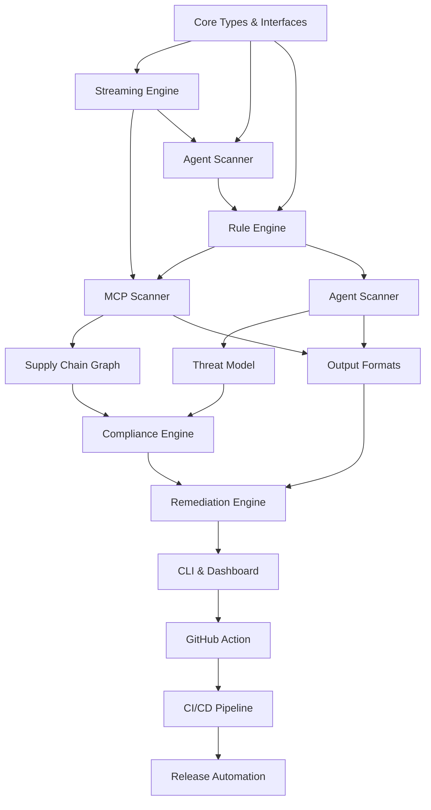

# Tasks: Core Scanning Engine

**Feature ID:** 001-core-scanner  
**Spec:** `specs/001-core-scanner/spec.md`  
**Plan:** `specs/001-core-scanner/plan.md`

---

## Task Dependencies

---

## Task List

### T1: Core Types & Interfaces ✅ DONE
**File:** `packages/core/src/types.ts`
- [x] `Finding` interface with all fields
- [x] `ScanTarget`, `ScanOptions`, `ScanResult`
- [x] `Finding` fingerprinting logic
- [x] `Severity`, `Confidence`, `ComplianceMapping` types
- [x] `Scanner` interface with `AsyncIterable<Finding>`
- [x] `ScannerContext` with logger, registry, signal

**Acceptance:** Types compile; used by all scanners

---

### T2: Streaming Engine ✅ DONE
**File:** `packages/core/src/engine.ts`
- [x] `scan()` returns `AsyncIterable<Finding>`
- [x] `scanToReport()` aggregates to `ScanReport`
- [x] Progress callbacks for long scans
- [x] Error handling without breaking stream

**Acceptance:** Streams findings without buffering; memory < 200MB for 10k LOC

---

### T3: Plugin Registry ✅ DONE
**File:** `packages/core/src/registry.ts`
- [x] `registerScanner()`, `getScanner()`
- [x] `registerRenderer()`, `getRenderer()`
- [x] `registerRemediator()`, `getRemediator()`
- [x] `ruleSet()` returns compiled `RuleSet`
- [x] Ownership tracking (core vs custom rules)

**Acceptance:** Scanners/renderers/remediators register without core modification

---

### T4: Rule Engine ✅ DONE
**Files:** `packages/core/src/rules/`
- [x] YAML loader (`loader.ts`)
- [x] 8 pattern types: regex, jsonpath, ast, entropy, assignment, import, config, composite
- [x] ReDoS validation at load time (`loader.ts`)
- [x] Evaluator (`evaluator.ts`) with `FileUnderScan`
- [x] Rule pack filtering by ownership
- [x] 6 packs, 76 rules loaded (`rules/index.ts`)

**Acceptance:** All 76 rules load; ReDoS patterns rejected at load

---

### T5: MCP Scanner ✅ DONE
**Files:** `packages/core/src/scanners/mcp/`
- [x] Config discovery (`discovery.ts`) - standard locations, VS Code, running processes
- [x] Config analysis (`analyzers.ts`) - unpinned, shell-wrapped, inline secrets, plaintext HTTP
- [x] Live introspection (`connectors.ts`) - stdio, HTTP, SSE transports
- [x] Protocol handling (`protocol.ts`) - MCP 2025-06-18
- [x] Supply chain graph (`graph.ts`) - exfiltration paths
- [x] Dual-pass: config + introspection

**Acceptance:** Finds unpinned installs, shell wrappers, inline secrets, exfil paths

---

### T6: Agent Scanner ✅ DONE
**Files:** `packages/core/src/scanners/agent/`
- [x] Framework detection (16 frameworks)
- [x] Prompt injection analysis (`prompt-injection.ts`)
- [x] Secret detection (`secrets.ts`) - 20+ prefixes + entropy
- [x] Threat modeling (`threat-model.ts`)
- [x] Framework-specific analyzers (`frameworks.ts`)

**Acceptance:** Detects 8 OWASP Agentic categories; redacts secrets in all outputs

---

### T7: Supply Chain Graph ✅ DONE
**File:** `packages/core/src/scanners/mcp/graph.ts`
- [x] Nodes: servers, tools, resources, prompts, credentials, external services
- [x] Edges: reads, writes, invokes, exfiltrates
- [x] Exfiltration path detection (credential → network)
- [x] D3 + Mermaid export

**Acceptance:** Finds credential→network chains; exports D3/Mermaid

---

### T8: Agent Threat Model ✅ DONE
**File:** `packages/core/src/scanners/agent/threat-model.ts`
- [x] Boundaries: agent, tools, data, user, external
- [x] STRIDE per boundary
- [x] Mermaid + Markdown export

**Acceptance:** Generates threat model with boundaries, STRIDE, mitigations

---

### T9: Output Formats ✅ DONE
**File:** `packages/core/src/output.ts`
- [x] JSON (complete document)
- [x] SARIF 2.1.0 (GitHub Code Scanning compatible)
- [x] Markdown (human review)
- [x] HTML (self-contained, dark mode)
- [x] CSV (spreadsheets)
- [x] JSONL (log pipelines)
- [x] Text (terminal, colored)

**Acceptance:** All 7 formats render valid output; SARIF validates

---

### T10: Compliance Engine ✅ DONE
**File:** `packages/core/src/compliance.ts`
- [x] 40+ controls across 7 frameworks
- [x] Finding → control mapping
- [x] Roll-up: control → findings, worst severity
- [x] Status assessment: fail | risk | no-findings | not-assessed
- [x] Attestation builder (Markdown + HTML)
- [x] Framework coverage matrix

**Acceptance:** 40+ controls; attestation with disclaimers; roll-up sorts by severity

---

### T11: Remediation Engine ✅ DONE
**File:** `packages/core/src/remediation.ts`
- [x] Auto-applied: secrets→env, `additionalProperties:true`→false, blanket auto-approval→explicit, shell→direct
- [x] Proposed: pin deps, replace `shell:true`, add iteration ceiling
- [x] Risks section + verification steps per remediation
- [x] `--apply` writes changes; fails closed on stale files
- [x] Unified diff generation

**Acceptance:** Auto-fixes apply correctly; proposed changes require review

---

### T11: CLI & Dashboard ✅ DONE
**Files:** `packages/cli/`, `packages/web/`
- [x] 8 commands: scan, redteam, sandbox, desktop, fix, report, intel, deps
- [x] Argument parsing (`args.ts`) with subcommands
- [x] Dashboard: scan history, graph, findings, compliance
- [x] Desktop app mode (Chrome/Edge `--app`)

**Acceptance:** All 8 commands work; dashboard serves history + graph

---

### T12: GitHub Action ✅ DONE
**Files:** `packages/action/`
- [x] `action.yml` with inputs/outputs
- [x] SARIF upload to code scanning
- [x] PR comment with findings summary
- [x] Zero deps (shells out to binary)

**Acceptance:** Runs in GitHub Actions; uploads SARIF; comments PR

---

### T13: CI/CD Pipeline ✅ DONE
**File:** `.github/workflows/ci.yml`
- [x] Verify: typecheck → unit → e2e → smoke → readiness
- [x] Package: build → verify → upload artifact
- [x] Self-scan: SARIF upload to code scanning
- [x] Self-scan regression gate (120 findings, 40 criticals ceiling)

**Acceptance:** All gates pass; artifact uploaded; self-scan gated

---

### T14: Release Automation
**Status:** PARTIAL
- [x] `npm run package` builds tarball
- [x] `npm run package:verify` installs + exercises
- [ ] `release.yml` workflow with manual approval
- [ ] SBOM generation (CycloneDX)
- [ ] Provenance attestation

**Acceptance:** `npm run package` → `dist/aegis-0.1.0.tgz`; `npm run package:verify` passes

---

### T15: Spec Kit Artifacts
**Status:** IN PROGRESS
- [x] `constitution.md`
- [x] `specs/001-core-scanner/spec.md`
- [x] `specs/001-core-scanner/plan.md`
- [x] `specs/002-red-team/spec.md`
- [x] `specs/002-red-team/plan.md` (next)
- [x] `specs/003-compliance/spec.md`
- [x] `specs/003-compliance/plan.md` (next)
- [ ] `tasks.md` for each spec
- [ ] `checklist.md` for each spec
- [ ] `/speckit.checklist` gate in CI

---

## Task Status Summary

| Task | Status | Files |
|------|--------|-------|
| T1: Core Types | ✅ | `types.ts` |
| T2: Streaming Engine | ✅ | `engine.ts` |
| T3: Plugin Registry | ✅ | `registry.ts` |
| T4: Rule Engine | ✅ | `rules/` |
| T5: MCP Scanner | ✅ | `scanners/mcp/` |
| T6: Agent Scanner | ✅ | `scanners/agent/` |
| T7: Supply Chain Graph | ✅ | `scanners/mcp/graph.ts` |
| T8: Agent Threat Model | ✅ | `scanners/agent/threat-model.ts` |
| T8: Output Formats | ✅ | `output.ts` |
| T9: Compliance Engine | ✅ | `compliance.ts` |
| T10: Remediation | ✅ | `remediation.ts` |
| T11: CLI & Dashboard | ✅ | `cli/`, `web/` |
| T12: GitHub Action | ✅ | `action/` |
| T13: CI/CD Pipeline | ✅ | `.github/workflows/ci.yml` |
| T14: Release Automation | ⚠️ Partial | `release.yml` missing |
| T15: Spec Kit Artifacts | ⚠️ In Progress | `constitution.md`, `specs/*/spec.md`, `specs/*/plan.md` |

---

## Next Actions

1. Create `specs/001-core-scanner/tasks.md` (this file) ✅
2. Create `specs/001-core-scanner/checklist.md`
3. Create `specs/002-red-team/tasks.md`
4. Create `specs/002-red-team/checklist.md`
5. Create `specs/003-compliance/tasks.md`
5. Create `specs/003-compliance/checklist.md`
6. Create `.github/workflows/release.yml`
6. Add `/speckit.checklist` gate to CI