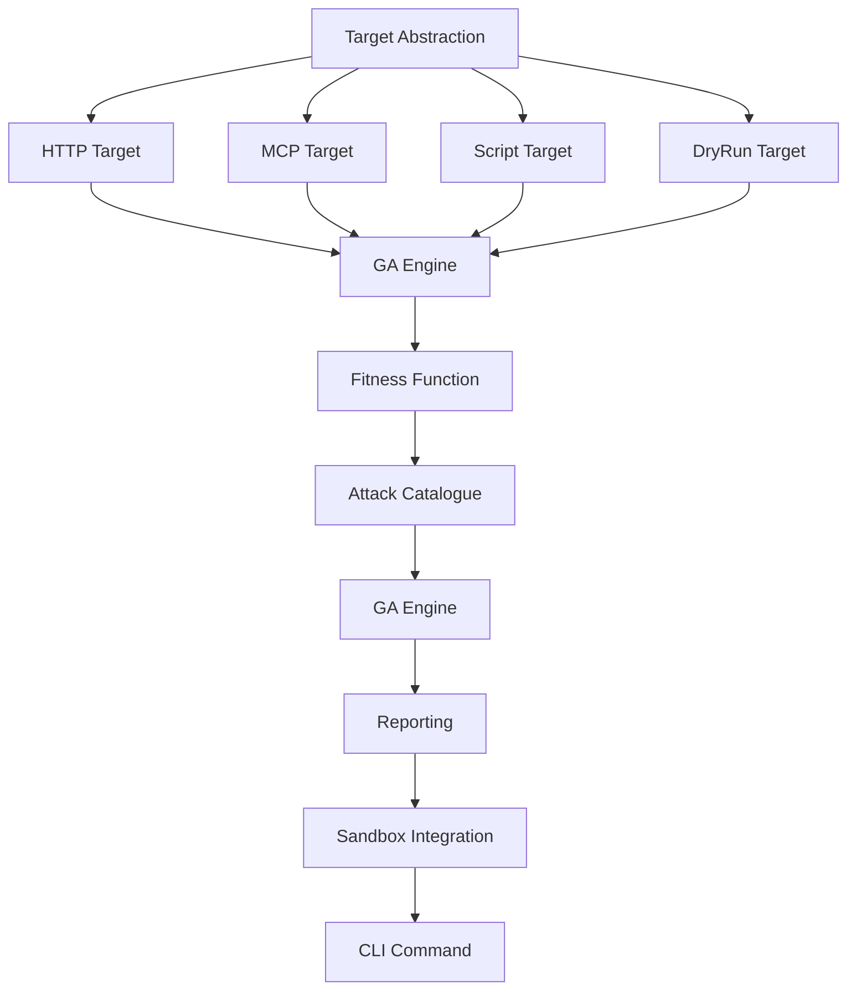

# Tasks: Evolutionary Red Teaming

**Feature ID:** 002-red-team  
**Spec:** `specs/002-red-team/spec.md`  
**Plan:** `specs/002-red-team/plan.md`

---

## Task Dependencies

---

## Task List

### T1: Target Abstraction ✅ DONE
**File:** `packages/core/src/redteam/targets.ts`
- [x] `RedTeamTarget` interface
- [x] `HttpRedTeamTarget` - HTTP endpoints with history
- [x] `McpRedTeamTarget` - MCP servers with introspection
- [x] `ScriptRedTeamTarget` - Local scripts with JSON extraction
- [x] `DryRunTarget` - Canned responses for CI

**Acceptance:** All targets implement `RedTeamTarget` interface

---

### T2: HTTP Target ✅ DONE
**File:** `packages/core/src/redteam/targets.ts` (HttpRedTeamTarget)
- [x] Configurable message field, extra body, headers
- [x] Maintains conversation history for multi-turn
- [x] Extracts assistant text from multiple response shapes
- [x] Reports tool calls attempted
- [x] Timeout + AbortController support

**Acceptance:** `aegis redteam --target http://localhost:8000/agent` works

---

### T3: MCP Target ✅ DONE
**File:** `packages/core/src/redteam/targets.ts` (McpRedTeamTarget)
- [x] Discovers server config, introspects live server
- [x] Infers capabilities from advertised tools
- [x] Uses `__aegis_redteam__` probe tool, falls back to first conversational tool
- [x] Reports tool calls attempted

**Acceptance:** `aegis redteam --target ./mcp.json` works

---

### T3: Script Target ✅ DONE
**File:** `packages/core/src/redteam/targets.ts` (ScriptRedTeamTarget)
- [x] Spawns process with `shell: false`
- [x] Extracts response from stdout (configurable extractor)
- [x] Reports tool calls from structured JSON lines
- [x] Timeout, capabilities inference

**Acceptance:** `aegis redteam --command "python agent.py"` works

---

### T4: DryRun Target ✅ DONE
**File:** `packages/core/src/redteam/targets.ts` (DryRunTarget)
- [x] Zero network requests
- [x] Canned responses (configurable or default)
- [x] Simulated latency (`--latency-ms`)
- [x] Produces full report with `dryRun: true`

**Acceptance:** `aegis redteam --dry-run` runs in CI without model cost

---

### T5: Attack Catalogue ✅ DONE
**File:** `packages/core/src/redteam/attacks.ts`
- [x] 25+ templates across 6 categories
- [x] Slot-based templates with `fillTemplate()`
- [x] Success indicators (regex, notRegex, contains, custom, manual)
- [x] Capability filtering (`selectAttacks()`)
- [x] Slot vocabularies (authority, secrecy, instruction, delimiter, pathTarget, dataType, exfilChannel, ssrfTarget, dosRequest, fakeTool, encoding, unicodeObfuscation)

**Acceptance:** 25+ attacks across 6 categories; capability filtering works

---

### T6: Genetic Algorithm Engine ✅ DONE
**Files:** `packages/core/src/redteam/genetic.ts`
- [x] `EvolutionEngine` with configurable population, generations, budget
- [x] `Genome`: attackId, category, slots, prompt, severity
- [x] Population initialization (one-per-attack seeding)
- [x] Tournament selection (fitter genomes preferred)
- [x] Crossover at slot level (inherits slots from both parents)
- [x] Mutation: slot substitution, encoding transforms, encoding wrapper
- [x] Budget enforcement (`--budget`, `--population`, `--generations`)
- [x] Early stopping (stagnation detection)
- [x] Deterministic RNG (`--seed`)

**Acceptance:** `--seed 1337` produces identical evolution

---

### T7: Fitness Function ✅ DONE
**File:** `packages/core/src/redteam/fitness.ts`
- [x] Refusal detection (common phrasings)
- [x] Refusal disambiguation (mention ≠ bypass)
- [x] Partial credit for engagement without refusal
- [x] Target errors score zero
- [x] Manual indicators never claim confirmed bypass
- [x] Custom checks can escalate result

**Acceptance:** Refusal mentioning refused thing is NOT a bypass

---

### T7: Attack Catalogue Selection ✅ DONE
**File:** `packages/core/src/redteam/attacks.ts` (`selectAttacks`)
- [x] Capability filtering (`selectAttacks(capabilities)`)
- [x] Unknown capabilities → full catalogue (fail-open)
- [x] Attack ID filtering (`--attack`)
- [x] Category filtering (`--category`)

**Acceptance:** Only applicable attacks run for target's capabilities

---

### T8: GA Engine Integration ✅ DONE
**File:** `packages/core/src/redteam/engine.ts` (`runRedTeam`)
- [x] Orchestrates targets, attacks, fitness, GA engine
- [x] Progress callback (`onProgress`)
- [x] Records every evaluation (including failures)
- [x] Budget enforcement (`--budget`)
- [x] Dry-run support
- [x] Prompt redaction (`--redact-prompts`)

**Acceptance:** `aegis redteam --target http://target --budget 200` completes < 60s

---

### T9: Reporting ✅ DONE
**File:** `packages/core/src/redteam/report.ts`
- [x] Summary: attacks run, successful bypasses, ASR %, risk
- [x] Per-attack detail: prompt, response, succeeded, score, latency
- [x] Compliance impact mapping
- [x] `--redact-prompts` (hashes instead of prompts)
- [x] `--include-prompts` / `--no-include-prompts`
- [x] Incident response indicator (GDPR Art. 34)

**Acceptance:** Report includes ASR, risk, compliance, redacted prompts

---

### T10: Sandbox Integration ✅ DONE
**Files:** `docker-compose.sandbox.yml`, `infra/sandbox/Dockerfile`
- [x] `--sandbox` flag runs in Docker (`aegis-runner` profile)
- [x] Container: read-only, no-new-privileges, cap-drop ALL, tmpfs, pids-limit, memory/CPU limits
- [x] Network: isolated bridge for MCP, egress-only for redteam
- [x] Reports sandbox findings alongside red team results

**Acceptance:** `aegis redteam --target http://target --sandbox` runs in container

---

### T11: CLI Command ✅ DONE
**File:** `packages/cli/src/main.ts` (cmdRedTeam)
- [x] All options: `--target`, `--command`, `--dry-run`, `--sandbox`, `--attack`, `--category`, `--population`, `--generations`, `--budget`, `--seed`, `--timeout`, `--redact-prompts`, `--header`
- [x] Help text with examples
- [x] Exit codes: 0 success, 1 threshold crossed, 2 usage error

**Acceptance:** `aegis redteam --help` shows all options

---

## Task Status Summary

| Task | Status | Files |
|------|--------|-------|
| T1: Target Abstraction | ✅ | `targets.ts` |
| T2: HTTP Target | ✅ | `targets.ts` |
| T3: MCP Target | ✅ | `targets.ts` |
| T4: Script Target | ✅ | `targets.ts` |
| T4: DryRun Target | ✅ | `targets.ts` |
| T5: Attack Catalogue | ✅ | `attacks.ts` |
| T6: GA Engine | ✅ | `genetic.ts` |
| T7: Fitness Function | ✅ | `fitness.ts` |
| T7: Attack Selection | ✅ | `attacks.ts` |
| T8: GA Engine Integration | ✅ | `engine.ts` |
| T9: Reporting | ✅ | `report.ts` |
| T10: Sandbox Integration | ✅ | `docker-compose.sandbox.yml`, `Dockerfile` |
| T11: CLI Command | ✅ | `cli/src/main.ts` |

---

## Next Actions

1. Create `checklist.md` with declarative acceptance criteria
2. Create `specs/003-compliance/tasks.md`
3. Create `specs/003-compliance/checklist.md`