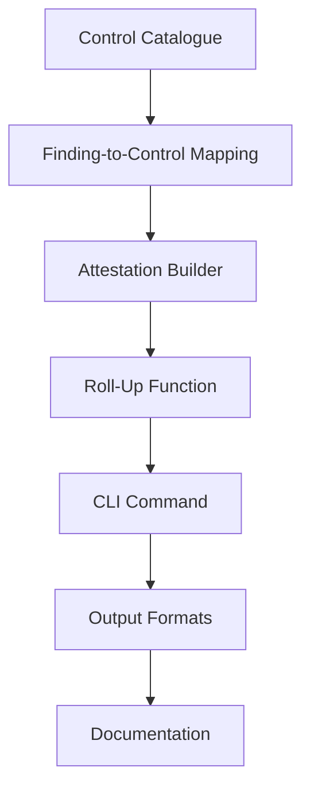

# Tasks: Compliance Attestation Engine

**Feature ID:** 003-compliance  
**Spec:** `specs/003-compliance/spec.md`  
**Plan:** `specs/003-compliance/plan.md`

---

## Task Dependencies

---

## Task List

### T1: Control Catalogue ✅ DONE
**File:** `packages/core/src/compliance.ts` (`CONTROLS` array)
- [x] 40+ controls across 7 frameworks
  - OWASP Agentic Top 10 (10)
  - OWASP LLM Top 10 (10)
  - SOC 2 (8): CC6.1, CC6.6, CC6.7, CC7.1, CC7.2, CC7.3
  - ISO 27001:2022 Annex A (10): A.5.15, A.5.17, A.8.3, A.8.6, A.8.8, A.8.15, A.8.19, A.8.20, A.8.26, A.8.28
  - GDPR (5): Art. 5, 25, 30, 32, 35
  - EU AI Act (7): Art. 9, 10, 12, 13, 14, 15
  - NIST AI RMF (5): GOVERN 1.2, 4.1; MAP 5.1; MEASURE 2.7; MANAGE 2.2
  - MITRE ATLAS (3): AML.T0050, T0051, T0054
- [x] Each control: id, framework, title, text, evidenceExpected
- [x] Optional: relatedTaxonomy, failureSeverity
- [x] `CONTROL_BY_KEY` map for O(1) lookup

**Acceptance:** `CONTROLS.length >= 40`; 7 frameworks represented

---

### T2: Finding-to-Control Mapping ✅ DONE
**File:** `packages/core/src/types.ts` (`Finding.compliance`), `packages/core/src/rules/`
- [x] `Finding.compliance: ComplianceMapping[]` on every finding
- [x] Rule packs declare `compliance` mappings per rule
- [x] `Finding.compliance` populated during `matchToFinding()`
- [x] Over-mapping prevented: only relevant controls

**Acceptance:** Every finding has `compliance` array; mappings are relevant

---

### T3: Attestation Builder ✅ DONE
**File:** `packages/core/src/compliance.ts` (`assessCompliance`, `toAttestationMarkdown`, `toAttestationHtml`)
- [x] `assessCompliance(findings, frameworks?)` → `ControlAssessment[]`
- [x] Status logic: `fail` | `risk` | `no-findings` | `not-assessed`
- [x] `failureSeverity` threshold per control (default: critical)
- [x] Evidence expected per control listed
- [x] `toAttestationMarkdown()` → Markdown with disclaimers
- [x] `toAttestationHtml()` → Self-contained HTML (no CDN)
- [x] Header: organisation, system, owner, scan date, Aegis version
- [x] Disclaimer: "Automated assessment of technical control evidence. Not a certification."
- [x] Three distinctions maintained:
  - "No findings" ≠ "pass"
  - "Not operating effective" only for critical findings
  - Limitations explicit (organisational/procedural out of scope)

**Acceptance:** `aegis report . --compliance --organisation "Acme" --system "Agent" --owner "SecTeam"` produces valid attestation

---

### T4: Roll-Up Function ✅ DONE
**File:** `packages/core/src/output.ts` (`rollUpCompliance`)
- [x] Aggregates findings by `framework:control`
- [x] Counts findings per control
- [x] Determines worst severity per control
- [x] Sorts by severity (critical→info) then count descending
- [x] Output: `{ framework, control, title?, count, worst }`

**Acceptance:** `rollUpCompliance(findings)` returns sorted control roll-up

---

### T4: CLI Command ✅ DONE
**File:** `packages/cli/src/main.ts` (cmdReport)
- [x] `aegis report [path] --compliance --organisation --system --owner --framework`
- [x] Options: `--format` (json|markdown|html), `--output`, `--min-severity`
- [x] Reuses scan options: `--no-connect`, `--no-spawn`, `--rule-dir`, `--rules`
- [x] Exit codes: 0 success, 1 threshold crossed, 2 usage error

**Acceptance:** `aegis report . --compliance --organisation "Acme" --system "Support Agent" --owner "SecTeam" --format html > attestation.html`

---

### T5: Output Formats ✅ DONE
**File:** `packages/core/src/output.ts` (`toMarkdown`, `toHtml`)
- [x] Markdown: header, summary table, findings, compliance roll-up
- [x] HTML: self-contained, dark mode, collapsible findings, compliance table
- [x] JSON: `AegisDocument` with compliance per finding
- [x] SARIF: compliance in rule properties + relationships

**Acceptance:** All 4 formats render compliance data correctly

---

### T5: Framework Coverage Matrix ✅ DONE
**File:** `packages/docs/content/docs/compliance.mdx`
- [x] Matrix: Framework × Control → Covered / Not Applicable
- [x] "Covered" = at least one rule maps to control
- [x] "Not Applicable" = requires organisational evidence
- [x] Documented in `docs/compliance.mdx`

**Acceptance:** Matrix shows coverage for all 40+ controls

---

## Task Status Summary

| Task | Status | Files |
|------|--------|-------|
| T1: Control Catalogue | ✅ | `compliance.ts` (CONTROLS) |
| T2: Finding-to-Control Mapping | ✅ | `types.ts`, `rules/`, `evaluator.ts` |
| T3: Attestation Builder | ✅ | `compliance.ts`, `output.ts` |
| T4: Roll-Up Function | ✅ | `output.ts` (rollUpCompliance) |
| T5: CLI Command | ✅ | `cli/src/main.ts` (cmdReport) |
| T5: Output Formats | ✅ | `output.ts` (toMarkdown, toHtml) |
| T5: Framework Coverage Matrix | ✅ | `docs/compliance.mdx` |

---

## Task Status Summary

| Task | Status | Files |
|------|--------|-------|
| T1: Control Catalogue | ✅ | `compliance.ts` (CONTROLS array) |
| T2: Finding-to-Control Mapping | ✅ | `types.ts`, `rules/`, `evaluator.ts` |
| T3: Attestation Builder | ✅ | `compliance.ts`, `output.ts` |
| T4: Roll-Up Function | ✅ | `output.ts` (rollUpCompliance) |
| T4: CLI Command | ✅ | `cli/src/main.ts` (cmdReport) |
| T5: Output Formats | ✅ | `output.ts` (toMarkdown, toHtml) |
| T5: Framework Coverage Matrix | ✅ | `docs/compliance.mdx` |

---

## Next Actions

1. Create `checklist.md` with declarative acceptance criteria